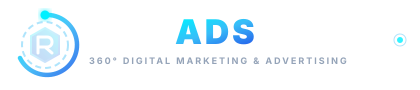

# RMS Ads — 360° Digital Marketing & Advertising Agency

Official company presentation and marketing website for **RMS Ads**, an integrated 360° Digital Marketing & Advertising Agency.



---

## 🚀 Overview

RMS Ads helps ambitious brands scale through strategic digital advertising, performance marketing, creator collaborations, and result-driven campaigns across multiple platforms.

### Approved V4 Frontend Implementation
- **Definitive V4 Design Aesthetic**: Navy (`#040814`, `#060D20`), royal blue (`#1D4ED8`, `#2563EB`), cyan (`#00F0FF`, `#38BDF8`), and crisp white typography.
- **Hero Composition**:
  - **Headline**: *Your Brand. Our Strategy. Unlimited Growth.*
  - **Subheadline**: *We help ambitious brands grow through strategic digital advertising, performance marketing, influencer collaborations, and result-driven campaigns across multiple platforms.*
  - **Primary CTA**: *Let's Work Together*
  - **Secondary CTA**: *Explore Our Services*
- **Agency Intro Headline**: *MORE THAN MARKETING. WE BUILD MOMENTUM.*
- **4-Step Methodology**: *Discover → Strategize → Execute → Optimize*
- **10 Core Capabilities**:
  1. Digital Marketing & Advertising
  2. Performance Marketing
  3. Influencer Marketing
  4. Brand Promotions
  5. Lead Generation
  6. Social Media Marketing
  7. Content Marketing
  8. Multi-Platform Campaign Management
  9. Education & EdTech Marketing
  10. Campaign Strategy & Media Planning
- **Client Brand Showcase**: Exact integration of `rms-ads-brand-logo-source-code` preserving the original V4 component layout, containers, hover effects, and CSS styling.
  - 10 Featured Brands: ALLEN, Careers360, Scaler School of Technology, Vedam School of Technology, Newton School of Technology, Unacademy, Physics Wallah (PW), PW Institute of Innovation (PW IOI), ALLEN Digital, Careerwill.
  - Authentic, local vector assets in `/public/clients/` with external CDN fallback handling.
- **Interactive Contact Engine**:
  - React Hook Form + Zod schema validation
  - Server-side Next.js route `/api/contact`
  - Resend email integration with rate limiting and bot honeypot protection

---

## 🛠️ Technology Stack

- **Framework**: Next.js 14 (App Router)
- **UI Library**: React 18, Tailwind CSS, Framer Motion
- **Icons**: Lucide React
- **Forms & Validation**: React Hook Form, Zod, `@hookform/resolvers`
- **Email Service**: Resend
- **Architecture**: Lightweight static presentation website (No PostgreSQL, Redis, Supabase, Prisma, or heavy backend required)

---

## 📂 Public-Facing Pages

1. **Home** (`/`) — Complete V4 homepage with all 10 approved sections
2. **About Us** (`/about`) — Agency origin, philosophy, leadership, and operating principles
3. **Services** (`/services`) — Detailed breakdown of all 10 capabilities with deliverables and benefits
4. **Industries** (`/industries`) — Tailored playbooks for EdTech, Higher Ed, D2C, FinTech, B2B SaaS, and Mobile Apps
5. **Our Clients** (`/clients`) — 10-brand showcase, partnership profiles, and enterprise credentials
6. **Case Studies** (`/case-studies`) — In-depth campaign breakdowns (ALLEN Digital, Scaler, Physics Wallah)
7. **Contact Us** (`/contact`) — Working lead capture form, Cyber City HQ info, and FAQ
8. **Partner With Us** (`/partner`) — Dedicated creator, influencer, and media network portal
9. **Privacy Policy** (`/privacy`) — Compliance and data protection policy
10. **Terms and Conditions** (`/terms`) — Legal terms and service agreements
11. **SEO Suite** (`/sitemap.xml`, `/robots.txt`, JSON-LD schema)

---

## 💻 Getting Started Locally

### 1. Install Dependencies
```bash
npm install
```

### 2. Configure Environment Variables
Copy `.env.example` to `.env.local`:
```bash
cp .env.example .env.local
```
Fill in your optional Resend API key:
```env
RESEND_API_KEY=re_your_api_key_here
CONTACT_NOTIFICATION_EMAIL=contact@rmsads.com
CONTACT_FROM_EMAIL=RMS Ads Enquiries <onboarding@resend.dev>
NEXT_PUBLIC_SITE_URL=http://localhost:3000
```
*(If `RESEND_API_KEY` is omitted, the form gracefully logs submissions locally without crashing).*

### 3. Run Development Server
```bash
npm run dev
```
Open [http://localhost:3000](http://localhost:3000) to view the site.

### 4. Build for Production
```bash
npm run build
npm run start
```

---

## ☁️ Deploying to Vercel

1. Push this repository to GitHub, GitLab, or Bitbucket.
2. Go to [vercel.com](https://vercel.com) and click **"Add New Project"**.
3. Import this repository.
4. Framework Preset will auto-detect as **Next.js**.
5. Add Environment Variables in Vercel Project Settings:
   - `RESEND_API_KEY`
   - `CONTACT_NOTIFICATION_EMAIL`
   - `NEXT_PUBLIC_SITE_URL`
6. Click **Deploy**. Your site will be live on Vercel's global edge network in seconds!

